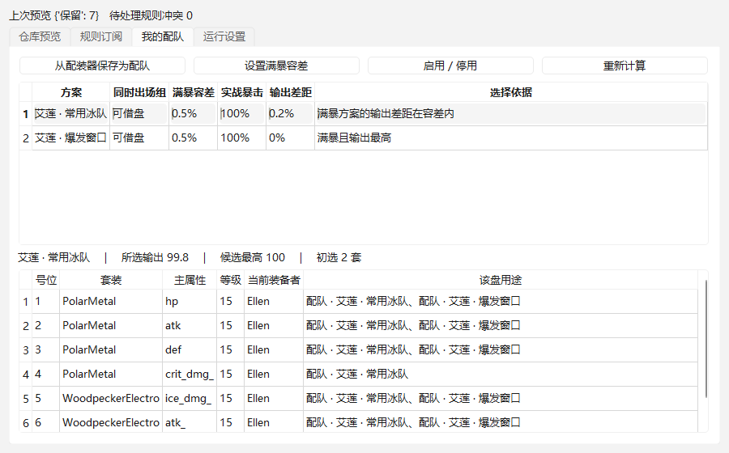

# OhMyZZZ

**绝区零一条龙 · 驱动盘管理插件**

刷完一轮，把各配队要穿的盘和备用盘留下，再按游戏里的弃置标记清背包。

[快速开始](#快速开始) · [配队与满暴](#配队与满暴) · [备用盘与弃置](#备用盘与弃置) · [配置示例](docs/configuration.md)

## 快速开始

1. 在绝区零一条龙的插件管理页安装**仓库扫描器**。已有本账号完整 ZOD 扫描的玩家可以直接导入，游戏内数量须与导出数量一致。[仓库扫描器](https://github.com/idk500/zzzod-plugin-inventory-scan)
2. 在 Releases 下载 `drive_disc_manager-版本号.zip` 及对应的 `.sha256`，校验后将 ZIP 导入一条龙。打开 **插件管理 → 驱动盘管理 → 设置**。[下载插件](https://github.com/EliNaCCa/OhMyZZZ/releases)
3. 在 **规则订阅 → 更新来源** 同步推荐表，再到 **仓库预览 → 导入本账号扫描** 看逐盘结果。预览会列出每张盘的号位、主属性、保留理由和待复核项。
4. 需要计算配装时，在本机配装器保存角色目标，保持服务运行，再到 **我的配队 → 从配装器保存为配队**。为队伍取名后即可计算六个号位。[本地多角色配装器](https://github.com/xliuforge/ZZZ_Multi_Agent_Drive_Optimizer)

## 配队与满暴

同一个主 C 可以保存多套方案。互斥队可以借用同一张盘，同时出场的角色填写相同分组，插件会尝试调整各自候选，让全员配齐。仓库保留所有启用方案用到的盘。

*配队页示例，使用演示库存。*

对于支持的直伤角色，插件读取配装器给出的实战暴击率与预期输出。每套配队可独立设置**为满暴最多接受的输出差距**，默认 **0.5%**。假设最高输出为 100、实战暴击率为 98%，结果如下。

| 最佳满暴方案输出 | 最终选择 | 原因 |
| ---: | --- | --- |
| 99.8 | 满暴方案 | 输出相差 0.2%，落在容差内 |
| 99.5 | 满暴方案 | 恰好触及 0.5% 上限 |
| 98.0 | 98% 暴击方案 | 选择最高输出，保留这 2% 收益 |

配装搜索目前使用 S 级满级盘，以及带有明确主属性数值的 S 级盘。结果页列出所选输出、候选最高输出和每个号位的实物。游戏内自动换装正在开发中。

## 备用盘与弃置

| 你想做的事 | 在插件里怎么设 |
| --- | --- |
| 给同类盘多留几张 | 在仓库预览选中一张盘，点「同类备用数量」。按套装、号位、主属性生效，支持零张、指定张数和不限。也可以单独把某张盘设为「始终保留」。 |
| 同时留偏暴击、偏暴伤的盘 | 在备用规则中分别填写用途和优先副词条。两种用途选到同一实物时只保留一张。[配置示例](docs/configuration.md) |
| 保留自己改过的规则 | 选择继承、额外接受或只接受。本地和上游改到同一字段时，本地值继续生效，打开设置页可处理冲突。 |
| 把标过的盘一起拆 | 在「运行设置」启用「标记后按游戏当前弃置拆解」，并在当前账号的一条龙任务中启用内置驱动盘拆解、勾选「全选已弃置」。游戏里仍挂着的旧标记和本轮新标记会一起拆，内置拆解设置的低品级范围也会生效。 |

默认打开的是预览。执行标记需要当前账号的完整扫描。若插件观察到你撤销了某张盘的弃置，它会记为手动保留。个人配队、规则与操作记录按账号保存在一条龙的 `plugin_data/drive_disc_manager/` 目录。

## 来源与维护

- 套装与主词条推荐来自清理表，角色倾向来自攻略表。同步失败时沿用最近一次成功的规则快照。[清理表](https://docs.google.com/spreadsheets/d/1ZIZa4zg0zkkPIP2TrHQaMw9XzjJLvO2iOpUAyREDFwY/edit?gid=133245023) · [角色攻略](https://docs.google.com/spreadsheets/d/e/2PACX-1vTj2PaPq6Py_1B5fsOPj_Moc-tN_7mut7fICczI6lz1njyEIAInTnfB7lAraX4pYCRGNbaHGlIbFZ90/pubhtml)
- OhMyZZZ 基于 idk500 的清理插件开发，保留 GPL-3.0 许可。GitHub Actions 检查上游变更、提交同步 PR，并为发布版本生成 ZIP 和 SHA-256。[上游项目](https://github.com/idk500/zzzod-plugin-disc-cleanup) · [许可证](LICENSE) · [发布记录](https://github.com/EliNaCCa/OhMyZZZ/releases)
