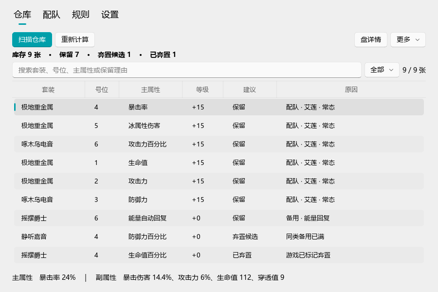

# OhMyZZZ

**绝区零一条龙 · 驱动盘管理插件**

刷完一轮，按自己的留盘规则挑胚子、留备用盘、标记弃置。需要给角色换盘时，再打开「我的配队」。

[快速开始](#快速开始) · [配队与满暴](#配队与满暴) · [备用盘与弃置](#备用盘与弃置) · [配置示例](docs/configuration.md)

## 快速开始

1. 在绝区零一条龙的插件管理页安装**仓库扫描器**。已有本账号完整 ZOD 扫描的玩家可以直接导入，游戏内数量须与导出数量一致。[仓库扫描器](https://github.com/idk500/zzzod-plugin-inventory-scan)
2. 从 Releases 下载 `OhMyZZZ-版本号.zip` 和对应的 `.sha256`，校验后将 ZIP 导入一条龙。点击 **插件管理 → OhMyZZZ → 设置**，在一条龙主窗口里配置当前账号。左上角的返回按钮会回到插件列表。[下载插件](https://github.com/EliNaCCa/OhMyZZZ/releases)
3. 在 **规则 → 规则订阅** 点「更新来源」。进入游戏大世界，在 **仓库** 点「扫描仓库」，或在「更多」里导入本账号的扫描文件。双击一张盘即可查看判定依据。
4. 在 **配队 → 配装器** 选择代理人、音擎和套装，保存角色目标后点页面右上角「导入方案」。在「我的配队」点「计算配装」。[本地多角色配装器](https://github.com/xliuforge/ZZZ_Multi_Agent_Drive_Optimizer)

在 **配队 → 面板对比** 可查看支援、击破和异常等职业换盘前后的属性。每项目标单独显示数值差和判定口径。

支持直伤评分的配队还会显示「换装后」相对当前六张盘的输出变化。当前穿戴的盘即使不满足新配装要求，也按相同配队和输出窗口比较。「输出差距」则以本次找到的最高输出方案为基准。

同场分盘按角色优先级计算。如果主 C 的两套盘输出相同、都满暴或都没满暴，且需要换的盘一样多，插件会把队友更需要的盘留给队友。在「配队」里还能看到扣除前序角色用盘后的最高输出。

**日常运行**　在一条龙的任务列表勾选 OhMyZZZ，排在刷盘之后。在「设置 → 运行设置」选择读取方式，设置每天、每周最多运行几次。默认使用游戏画面（OCR），也可选[网络读取](docs/network-reader.md)。开启「自动标记驱动盘」后，要留的锁定，要拆的标记为弃置。需要拆解时，把一条龙的「驱动盘拆解」排在后面。

## 配队与满暴

同一个主 C 可以保存多套方案。互斥队可以借用同一张盘，同时出场的角色填写相同分组，插件会尝试调整各自候选，让全员配齐。仓库保留所有启用方案用到的盘。

在 **配队 → 管理方案 → 复制为另一配队** 可以从常态队复制出爆发队，再调整输出窗口。副本沿用角色目标，初始分组允许借盘。

*配队页示例，使用演示库存。*

对于支持的直伤角色，**满暴**指算上角色和队伍加成后，实战暴击率达到 100%。97.6% 差一条暴击副词条，按 97.6% 算伤害。超过 100% 的部分按 100% 算，攻击、暴伤等词条照常计入。[配装器评分源码](https://github.com/xliuforge/ZZZ_Multi_Agent_Drive_Optimizer/blob/2205dd3b59264ac9ca82cf5dd47818bff1fa6ebb/main.go#L4716-L4775)

直伤配队在输出接近时优先满暴。在 **我的配队 → 管理方案 → 队伍成员** 调整「为满暴最多接受的输出差距」，默认 **0.5%**。例如满暴少 0.2% 或恰好少 0.5% 输出，就选满暴。少 2% 就选输出更高的一套。设为 0%，只有输出并列最高时才优先满暴。

配装搜索目前使用 S 级满级盘，以及带有明确主属性数值的 S 级盘。结果页列出所选输出、候选最高输出和每个号位的实物。

**配队 → 管理方案 → 输出窗口** 可以设置常态与爆发各占多少输出，以及哪个窗口优先满暴。插件将同一套盘的逐窗口实战输出加权，配队预览展示各窗口的暴击率及输出。[配置示例](docs/configuration.md)

在「我的配队」点「计算配装」查看方案，再点「一键换装」查看本次穿戴清单。已验证六盘模拟换装，实机穿戴待验证。[换装与恢复](docs/configuration.md#换装与恢复)

## 备用盘与弃置

在 **角色留盘** 页可以自动纳入扫描到的角色，也可以多选准备培养的角色。订阅表提供四件套、两件套、主词条和副词条依据。仓库预览会显示推荐一张盘的角色与来源字段。通用备用名额有限时，插件按匹配角色的有效副词条档数挑选；自定义用途使用你指定的副词条。

| 你想做的事 | 在插件里怎么设 |
| --- | --- |
| 提前设好多个套装的名额 | 在「备用规则」选套装，按需指定号位和主属性。比如给摇摆爵士所有 5 号盘设偏暴击名额，再为其中的攻击力主属性单设张数。下次计算库存时，这些规则一同生效。 |
| 给同类盘多留几张 | 在仓库预览选中一张盘，点「同类备用数量」。按套装、号位、主属性生效，支持零张、指定张数和不限。也可以单独把某张盘设为「始终保留」。 |
| 给异常队留盘，先看会多留多少 | 在「同类备用数量」点「添加用途」，勾选异常精通等副词条。有当前库存预览时点「预览这次调整」，可查看实际保留张数和新增弃置候选。 |
| 同时留偏暴击、偏暴伤的盘 | 在「同类备用数量」中分别设置「偏暴击」「偏暴伤」，需要精简同类推荐盘时选「推荐盘也按同类名额筛选」。选中一张盘，可以查看每个用途的覆盖数和去重后的实际备用数。[配置示例](docs/configuration.md) |
| 保留自己改过的规则 | 选择继承、额外接受或只接受。本地和上游改到同一字段时，本地值继续生效，打开设置页可处理冲突。 |
| 把标过的盘一起拆 | 在「运行设置」启用「自动标记驱动盘」。一条龙内置「驱动盘拆解」勾选「全选已弃置」后，会按任务顺序处理游戏里仍挂着的旧标记、本轮新标记和配置的低品级盘。 |

单独运行 OhMyZZZ 时，当前宿主只能提供快速选择按钮，插件止于标记。在 **设置 → 库存记录** 可查看哪些盘离开了仓库。独立拆解任务使用一条龙自己的品级与弃置筛选。

默认打开的是预览。执行标记需要当前账号的完整扫描。若插件观察到你撤销了某张盘的弃置，它会记为手动保留。个人配队、规则与操作记录按账号保存在一条龙的 `plugin_data/drive_disc_manager/` 目录。

## 来源与维护

同一功能的改进会集中发布。每次更新都附上中文说明，列出对配装、留盘或清包的实际影响。[更新日志](drive_disc_manager/CHANGELOG.md)

一条龙启动时会提示 OhMyZZZ 的新版本。空闲时点「立即更新」即可在当前窗口加载新版，也可选择「退出后更新」。在 **OhMyZZZ → 版本维护** 可以关闭启动提示、手动检查更新或回退上一版。[启动提示与回退](docs/configuration.md#启动提示与回退)

- 套装与主词条推荐来自清理表，角色倾向来自攻略表。同步失败时沿用最近一次成功的规则快照。[清理表](https://docs.google.com/spreadsheets/d/1ZIZa4zg0zkkPIP2TrHQaMw9XzjJLvO2iOpUAyREDFwY/edit?gid=133245023) · [角色攻略](https://docs.google.com/spreadsheets/d/e/2PACX-1vTj2PaPq6Py_1B5fsOPj_Moc-tN_7mut7fICczI6lz1njyEIAInTnfB7lAraX4pYCRGNbaHGlIbFZ90/pubhtml)
- OhMyZZZ 基于 idk500 的清理插件开发，保留 GPL-3.0 许可。GitHub Actions 检查上游变更、提交同步 PR，并为发布版本生成 ZIP 和 SHA-256。[上游项目](https://github.com/idk500/zzzod-plugin-disc-cleanup) · [许可证](LICENSE) · [发布记录](https://github.com/EliNaCCa/OhMyZZZ/releases)
